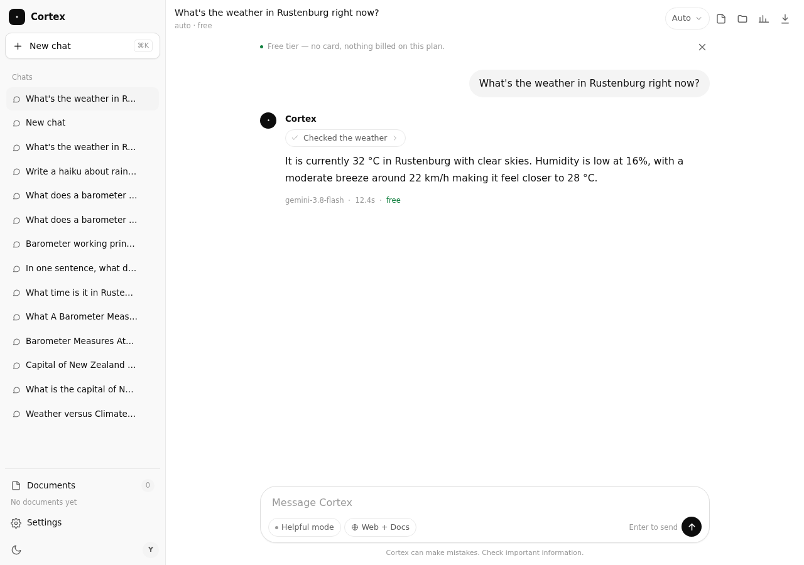
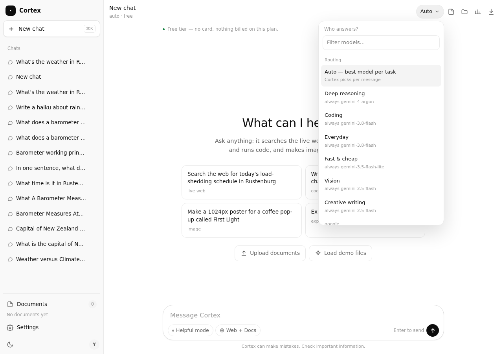
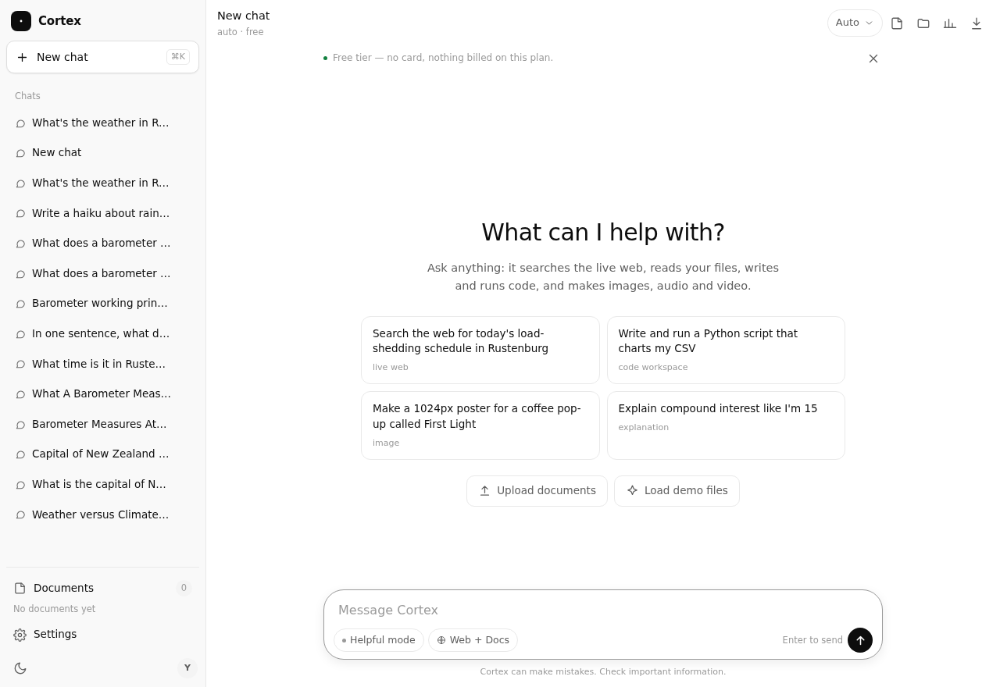
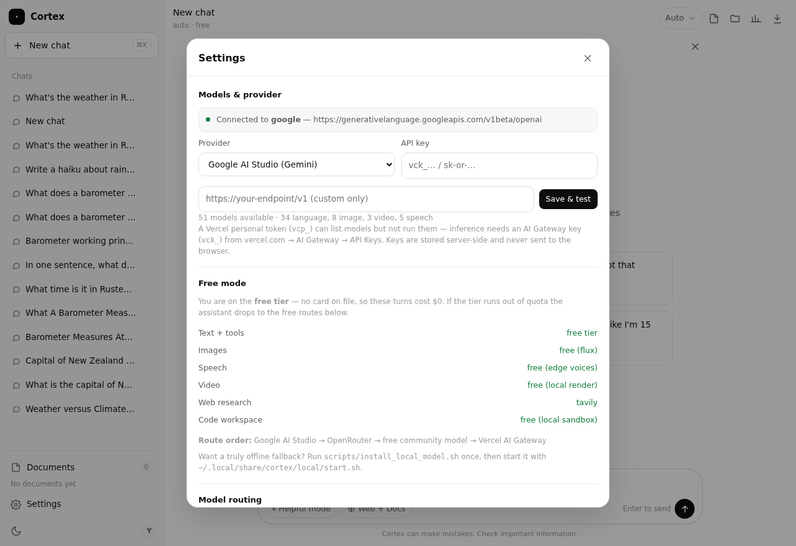
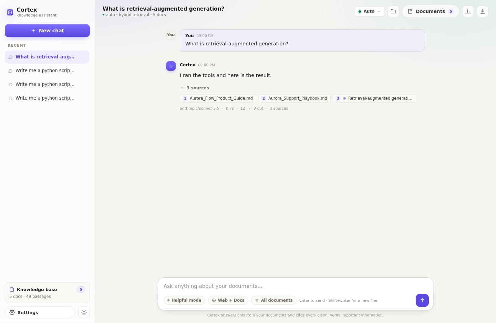
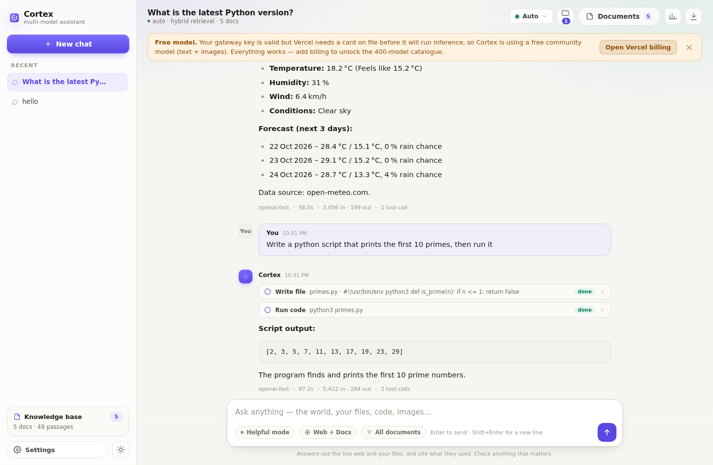
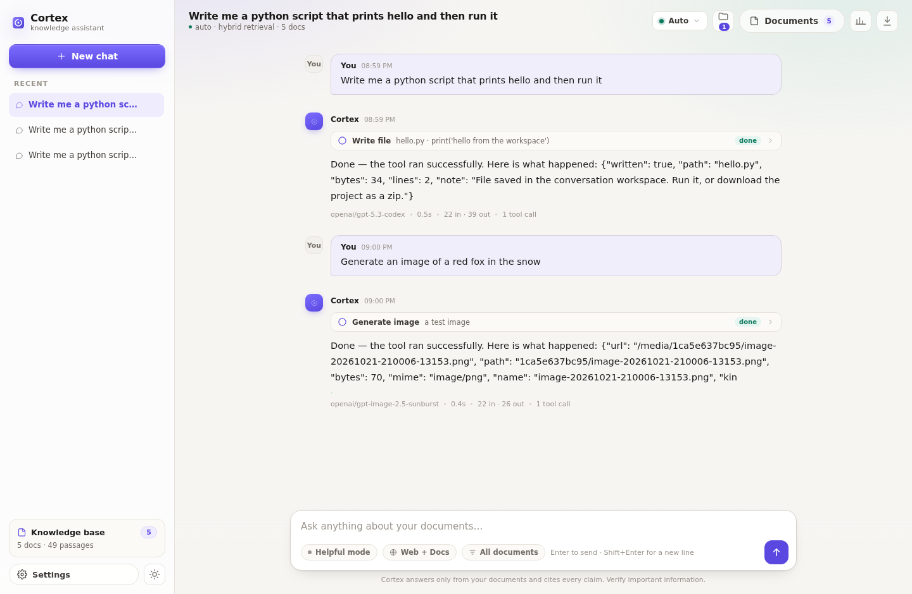
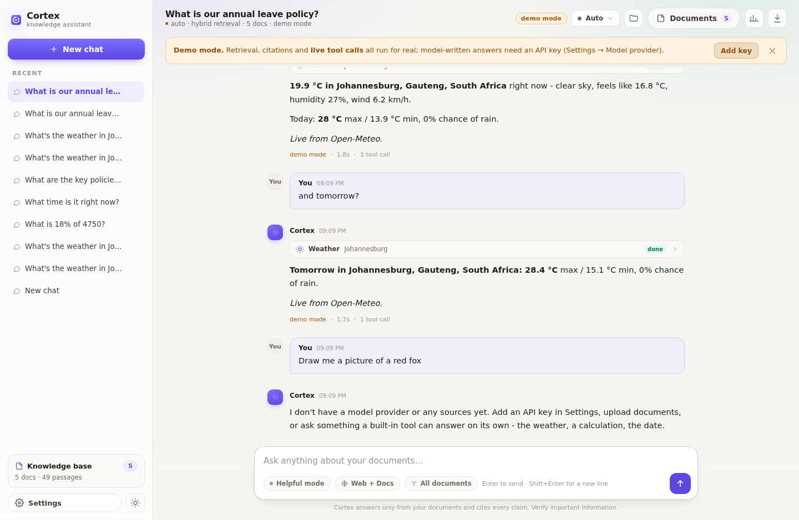
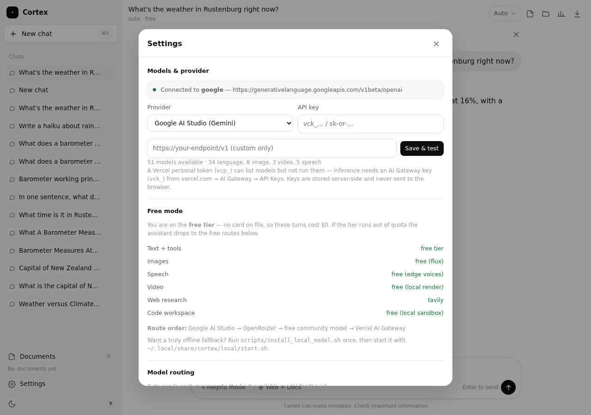
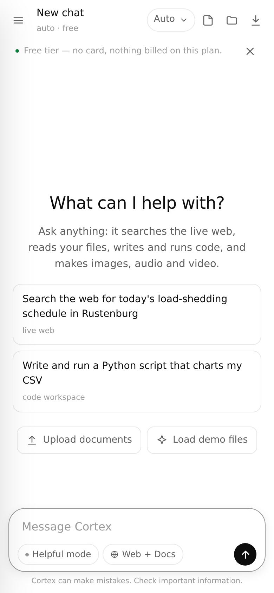

# Cortex

A multi-model AI assistant you run yourself. It routes every message to the model that is best at
that kind of work, answers from **the live internet by default** (your documents become an optional
extra layer), writes and runs real code in a project workspace, and generates images, speech and
video.

Not a wrapper around one provider. One key — a Vercel AI Gateway key, or OpenRouter, or OpenAI,
Groq, DeepSeek, Together, or a local Ollama — unlocks every model behind it, and Cortex picks per
task. **No key at all also works**: text, images, speech, video, web research and the code
workspace all run on free routes, with a local model as the offline last resort.

```
one message → classify the task → pick the best available model → answer with tools if needed
```



---

## What it does

| | |
| --- | --- |
| **Answers about the world** | Web research (search → read the top pages → cite them) is on by default. No uploading required. |
| **Answers about your files** | Upload PDF/DOCX/MD/CSV/HTML/text and Cortex retrieves from them with hybrid BM25 + embeddings + cross-encoder reranking. Keep it as a layer or make it the only source. |
| **Routes every task** | Reasoning, coding, general chat, fast lookups, creative writing, vision, image, speech and video each have their own preferred model and their own fallback chain. The UI shows which model answered and why. |
| **Builds software** | Writes files into a per-conversation workspace, runs them (`python3`, `node`), streams stdout/stderr back, and ships the folder as a zip. |
| **Makes media** | Text→image, text→speech, text→video — all with free routes. Artefacts are stored per conversation, shown inline, and re-playable. |
| **Calls APIs** | 14 built-in tools including weather, Wikipedia, URL fetch, web search, arithmetic and the clock — plus any host you add with a credential. |



---

## Model routing — the Arena idea, in one file

`app/router.py` is deliberately small and readable: a preference table per task, a probabilistic
tie-break on live model metadata, and a fallback chain built from whatever the provider actually
offers.

| Task | Picks first | Why | Falls back to |
| --- | --- | --- | --- |
| `reasoning` | `openai/gpt-6.1-sol` | strongest multi-step reasoning | `anthropic/claude-opus-5.5`, `google/gemini-4-argon` |
| `code` | `openai/gpt-5.3-codex` | code-tuned, long context | `anthropic/claude-sonnet-5.5`, `qwen3-coder` |
| `general` | `anthropic/claude-sonnet-5.5` | best all-rounder | `openai/gpt-5.5`, `gemini-3.8-flash` |
| `fast` | `google/gemini-3.5-flash-lite` | cheap + quick | `gpt-5.4-nano`, `claude-haiku-5.5` |
| `creative` | `anthropic/claude-opus-5.5` | voice and structure | `gpt-6.1-sol` |
| `vision` | `google/gemini-4-argon` | image input | `gpt-5.5`, `claude-opus-5.5` |
| `image` | `openai/gpt-image-2.5-sunburst` | quality + prompt adherence | `flux-3`, `seedream-5`, `recraft-v4.1` |
| `speech` | `openai/tts-1-hd` | natural narration | `gemini-3.8-flash-tts`, `mai-voice-2.1` |
| `video` | `google/veo-3.1-generate-001` | best text→video | `kling-v3.0-t2v`, `seedance-2.5` |

The names above come from the live catalogue, not from this file — if a model disappears, the
router drops to the next match by family and capability tags (`reasoning`, `tool-use`, `vision`,
`code`). Nothing breaks when the vendor reshuffles.

You can override the router for a single message from the model menu (**Auto** keeps routing).
Every answer carries a footer with the model, the task class, latency, tokens and cost.

---

## Free mode — no account, no card, no bill

Cortex answers with **nothing configured**. `gateway.pool()` lists every route this install can
reach, and `agent.stream()` walks it in order: if one is rate-limited, out of credit or simply down,
the reply continues on the next one with a notice saying where it landed. You never see a dead end.

| Capability | Free route | Quality |
| --- | --- | --- |
| **Chat, reasoning, code, tools** | keyless community model (`openai-fast`, GPT-OSS 20B) | strong at tools and code, ~20–60 s per answer |
| **Offline fallback** | local llama.cpp + Qwen2.5 0.5B (`scripts/install_local_model.sh`) | always up, no network, smaller answers |
| **Images** | keyless Flux renderer, queued and retried | 1024², stored locally, 5–30 s |
| **Speech** | Edge neural voices (free, no key, no quota) | natural, 1–2 s per paragraph |
| **Video** | local ffmpeg: generated stills + camera moves + voice-over | 6–12 s clip in ~45 s, 1280×720 |
| **Web research** | Tavily free tier, else DuckDuckGo + Wikipedia | real sources with citations |
| **Code workspace** | local sandbox, `python3`/`node`, zip download | real stdout, real exit codes |

### If you already have an OpenRouter key

OpenRouter is the widest catalogue in one key, and **its free models cost nothing** — 21 of the 468
models in Cortex's OpenRouter catalogue are zero-price (`nvidia/nemotron-3-ultra-550b-a55b:free`,
`minimax/minimax-m3.1-flash:free`, `cohere/north-mini-code:free`, `thinkingmachines/inkling:free`…).

```bash
OPENROUTER_API_KEY=sk-or-v1-…
```

Cortex reads `GET /credits` once an hour. **No credit → free-only mode:** every paid model is
filtered out of the catalogue before routing, so a $0 key can never produce a 402, and the footer
stays at `$0.0000`. Add credit later and the paid catalogue unlocks automatically — no setting to
flip. Free-tier rate limits (20 requests/minute, 50/day until the account has bought $10 of credit, then
1,000/day) are absorbed the same way as any other provider: retry, park the model, move on. On a $0
key Cortex also skips the optional follow-up suggestions, so the daily budget goes to answers.

### If you already have a Google AI Studio key

A [Google AI Studio](https://aistudio.google.com/apikey) key is the best *free* upgrade: its free
tier needs **no card**, and it adds Gemini 3.x Flash to the front of the pool. Paste it in
**Settings → Model provider** or put it in `.env`:

```bash
GEMINI_API_KEY=AQ.…            # or AIza…
CORTEX_PROVIDER=google        # optional: lead with it
```

Cortex talks to the OpenAI-compatible endpoint
(`generativelanguage.googleapis.com/v1beta/openai`), so routing, tools and streaming are identical
to every other provider. Three details are handled for you:

- **Free-tier pacing.** Gemini meters requests per minute *per model*. Cortex paces its calls
  (`CORTEX_GOOGLE_RPM`, default 9), and when a model is still out of budget it parks that model for
  an hour and tries the next one — then the keyless route, then local. A 429 never ends a turn.
- **Tool calls keep working.** Gemini 3 attaches an opaque `thought_signature` to each tool call and
  rejects the follow-up turn if it is missing; Cortex stores it and echoes it back.
- **Chat-only provider.** The compatibility layer has no image, speech or video endpoints, so those
  requests go straight to the free renderers instead of failing on a 404.

With the key active the banner reads **Free tier** (not "free mode"), and every answer's footer shows
the Gemini model that answered next to `$0.0000`.

Pro models (`gemini-3.1-pro-preview`, `gemini-4-argon`) exist in the catalogue but have **zero free
quota** — Cortex will skip them unless a paid plan is attached. Flash models are the ones that
answer on the free tier.

Add a key and it slots in front of these routes — a Google AI Studio key or an OpenRouter key with
$0 credit both stay at **$0.00** while making answers faster (see below).



Settings → **Free mode** shows the live route order and which capabilities are free, so the
trade-off is never hidden. Nothing in this mode is billed: the usage footer reports `$0.0000` and
names the provider that answered.



### Make it unlimited offline

The keyless community model is a shared, polite endpoint: one request at a time, no SLA. To remove
even that dependency:

```bash
pip install -r requirements.txt                       # includes edge-tts + a bundled ffmpeg
./scripts/install_local_model.sh --small              # ~25 MB of binaries + a 470 MB model, no root
~/.local/share/cortex/local/start.sh          # serves on 127.0.0.1:8080
```

Cortex detects the server on the next message and adds *local llama.cpp* to the pool as a
last-resort fallback — it keeps answering with the network unplugged. `--large` picks a 3B model if
your machine has the RAM. Set `CORTEX_FREE_MODEL=0` to disable the remote free route entirely and
run purely on the local model.

## Knowledge: web first, documents when you want them

Three modes, switchable in the composer:

| Mode | What it uses |
| --- | --- |
| **Web + documents** (default) | Live web research for anything current, plus your files when they're relevant |
| **Web only** | Ignores uploads entirely |
| **Documents only** | Classic RAG: answers only from your files, and says so when they don't cover it |

Search backends, in order of preference:

| Backend | Key | Coverage |
| --- | --- | --- |
| Tavily | `TAVILY_API_KEY` (free tier) | Full web, best snippets |
| Brave Search | `BRAVE_API_KEY` | Full web |
| SearXNG | `CORTEX_SEARX_URL` | Full web, self-hosted |
| Keyless fallback | none | Wikipedia, Hacker News, Stack Overflow, GitHub + DuckDuckGo instant answers |

The keyless path is real but narrow: excellent for technical and encyclopaedic questions, weak for
shopping, prices and general news. If you want "anything on the internet", add a Tavily key — it's
free for 1 000 searches a month. Cortex labels the active backend in **Settings → Knowledge**.

After searching, it fetches the top pages, extracts readable text, ranks the passages and cites
them as numbered sources you can click.



---

## Code workspace

Each conversation gets a folder under `data/workspaces/<conversation>/`. The agent has four tools
bound to it: `write_file`, `read_file`, `list_files`, `run_code`.

- It writes complete files, then runs them and reports the real exit code and output.
- `run_code` executes with an argv allowlist (`python3`, `node`, `npm run`, `ls`, `cat`, …) inside
  the workspace directory, with a timeout and output cap. No shell metacharacters, no binaries
  outside the allowlist.
- The workspace badge in the header shows the file count; the drawer lists files with sizes; the
  whole project downloads as a zip.



---

## Media

Ask for a picture, a voice-over or a short video and the agent calls the matching tool. Generation
runs through the same provider key:

- **Image** — OpenAI Images, Flux, Seedream, Recraft (whichever the provider serves).
- **Speech** — TTS with selectable voice; audio plays inline.
- **Video** — long-running jobs are submitted and polled; the finished file appears in the chat.



Images work with no key at all (Flux, via the keyless fallback; the file is stored locally, not
hot-linked). Speech and video need a provider key, and the tools are hidden rather than offered and
failing when the active provider cannot serve them.

---

## Tools

Fourteen, all with schemas the model can call, all switchable in **Settings → Tools**:

| Tool | What it does | Key |
| --- | --- | --- |
| `web_search` | Search the web (Tavily/Brave/SearX/keyless) | optional |
| `deep_research` | Search, then read and rank the top pages | optional |
| `fetch_url` | GET any URL or JSON API, return readable text | — |
| `wikipedia` | Article extract | — |
| `weather` | Current conditions + 3-day forecast (Open-Meteo) | — |
| `calculator` | Exact arithmetic in a restricted AST evaluator | — |
| `current_datetime` | Real clock, any IANA timezone | — |
| `write_file` / `read_file` / `list_files` | Workspace files | — |
| `run_code` | Execute python/node in the workspace | — |
| `generate_image` / `text_to_speech` / `generate_video` | Media generation | provider |

`fetch_url` goes through an SSRF guard (private, loopback, link-local and metadata addresses are
rejected before the request leaves the process) and an optional host allowlist. Credentials you add
per host are injected server-side, never placed in the prompt and never sent back to the browser.

---

## Quick start

```bash
git clone <repo> && cd cortex
python -m venv .venv && source .venv/bin/activate
pip install -r requirements.txt
cp .env.example .env          # add one provider key (see below)
python run.py                 # http://localhost:8000
```

Or with Docker:

```bash
docker compose up --build
```

First run downloads the embedding model (~90 MB) and the reranker (~80 MB) once, then works
offline for retrieval.

### Which key unlocks what

| Key | Chat | Routing across many models | Images | Speech | Video | Full web search |
| --- | --- | --- | --- | --- | --- | --- |
| Vercel AI Gateway (`vck_…`) | ✅ | ✅ hundreds of models | ✅ | ✅ | ✅ | needs Tavily/Brave |
| OpenRouter (`sk-or-…`) | ✅ | ✅ free models with a $0 key, all models with credit | free renderer | free voices | free renderer | needs Tavily/Brave |
| OpenAI (`sk-…`) | ✅ | GPT only | ✅ | ✅ | — | needs Tavily/Brave |
| Groq / DeepSeek / Together | ✅ | their models | — | — | — | needs Tavily/Brave |
| Google AI Studio (`AQ.…` / `AIza…`) | ✅ | Gemini Flash models (free tier, no card; pro needs billing) | free renderer | free voices | free renderer | needs Tavily/Brave |
| Ollama (local) | ✅ | local models | — | — | — | needs Tavily/Brave |
| none | demo mode | — | — | — | — | keyless fallback |

> **A Vercel personal access token (`vcp_…`) can list the catalogue but cannot run inference.**
> Create an AI Gateway key (`vck_…`) at
> [Vercel → AI Gateway → API keys](https://vercel.com/d/[team]/~/ai-gateway/api-keys?showCreateKeyForm)
> and paste that instead. Cortex validates the key with a real one-token completion before saving,
> so a key that can't infer is rejected up front.

Set it in `.env` as `AI_GATEWAY_API_KEY=…`, or paste it into **Settings → Model provider** (held in
server memory for the session, never written to disk).

---

## Demo mode

With no key the app still runs, and it says so:

- documents, retrieval, citations and the workspace toolbar work;
- the keyless search path is live;
- a small deterministic planner runs the live tools (`weather`, `calculator`, `current_datetime`,
  `wikipedia`, `search`) so the HTTP calls and their results are real;
- answers are extractive instead of model-written, and the model menu explains that routing needs
  a provider.

That's what `python tests/smoke_test.py` exercises, so the keyed path is covered by a fake provider
in CI without spending tokens.



---

## API

| Method | Path | Purpose |
| --- | --- | --- |
| `POST` | `/api/chat` | SSE stream: `start, sources, tools, route, tool_start, tool_result, media, delta, notice, grounding, followups, usage, title, done, error` |
| `GET` | `/api/health` | provider, models, retrieval, web backend, stats |
| `GET/POST/DELETE` | `/api/key` | provider credential (`{provider, api_key, base_url}`) |
| `GET` | `/api/models?force=1` | catalogue + routing table |
| `GET/POST` | `/api/documents` | list / upload |
| `GET/POST` | `/api/workspace/{conv}/…` | `files`, `file`, `run`, `download` |
| `GET` | `/api/media/{conv}/list` | generated artefacts |
| `GET/POST` | `/api/tools`, `/api/tools/{name}/test` | tool catalogue, settings, try-it |
| `GET` | `/api/search?q=` | probe retrieval directly |
| `GET` | `/api/conversations/{id}/export` | Markdown export |

Full list in `app/main.py`; the SSE contract is stable enough to drive your own client.

---

## Tests

```bash
python tests/smoke_test.py        # 50 — end-to-end HTTP with a faked provider seam
python tests/tools_test.py        # 34 — tool executors, SSRF, allowlist, secret masking
python tests/agent_loop_test.py   # 20 — tool loop: replay, round cap, failures, unknown tool
python tests/free_test.py         # 19 — provider pool, failover, free media routing (offline)
python tests/gemini_test.py       # 32 — Google free tier, quota vs billing, signatures, parking
python tests/openrouter_test.py   # 22 — $0 key routes to free models only, credit flips it back
python tests/auth_test.py         # 38 — login page, cookie flags, open-redirect guard, Basic, logout
python tests/tooltext_test.py     # 28 — tool calls written as text: parsing, chunk splits, no false positives
python tests/speed_test.py        # 18 — stalled streams abandoned, 429 reset windows, no false timeouts
python tests/provider_order_test.py  # 4 — a $0 OpenRouter key never leads a turn
python tests/eval_retrieval.py    # retrieval quality on a golden set
```

Retrieval numbers on the bundled corpus (49 chunks, 18 golden questions):

| Metric | Value |
| --- | --- |
| Recall@1 | 0.818 |
| Recall@3 | 0.970 |
| Recall@8 | 1.000 |
| MRR | 0.898 |
| Median retrieval | ~225 ms |

`tests/mock_provider.py` is an OpenAI-compatible fake (chat, tools, images, speech, video) used by
the suites — it lets the whole agent loop run in CI without a key.

---

## When a model misbehaves

Two failures are common enough on free routes that they are handled by name.

**A model prints the tool call instead of making one.** Some open-weight models
(Nemotron on OpenRouter, seen in production) emit

```text
<tool_call>
<function=fetch_url>
<parameter=url>
http://example.org
</parameter>
</function>
</tool_call>
```

as *content*. `app/tooltext.py` filters the delta stream: it holds back anything
that could be the start of a tag (a tag can be split across two chunks), turns a
complete block into a real tool call, and drops the markup. A stray
`<tool_call>` in ordinary prose is left alone, and a bare `<function=x>` only
counts when `x` is a tool actually offered that turn.

**A model sits in a queue.** `gateway.chat_stream(..., first_token=20)` abandons
a stream that has produced no content in that window, parks the model for 15
minutes and returns a retryable error, so the turn moves to the next model
instead of hanging. Reasoning tasks get 45 s, coding 25 s. On top of that a turn
has a 75 s budget: past it the model answers with the tool results it already
has rather than starting another round. A 429 also carries its own reset window
(OpenRouter's daily cap is hours, not a minute), so a dead provider is skipped
instead of being retried every turn.

## Configuration



Set in `.env` or the environment:

| Variable | Default | Purpose |
| --- | --- | --- |
| `AI_GATEWAY_API_KEY` | — | Vercel AI Gateway key (`vck_…`) |
| `OPENROUTER_API_KEY` / `OPENAI_API_KEY` / `GROQ_API_KEY` / `DEEPSEEK_API_KEY` / `TOGETHER_API_KEY` | — | Alternative providers |
| `CORTEX_PROVIDER` | auto | Force a provider (`gateway`, `openrouter`, `openai`, `ollama`, `custom`, `free`) |
| `CORTEX_FREE_MODEL` | `1` | Keyless fallback when no key works (`0` disables it) |
| `CORTEX_LOCAL_MODEL` | `1` | Use a local llama.cpp/Ollama server as fallback (`0` disables) |
| `CORTEX_LOCAL_URL` | `http://127.0.0.1:8080/v1` | Where that server listens |
| `CORTEX_TTS_VOICE` | `en-US-AriaNeural` | Default free voice |
| `CORTEX_FFMPEG_TIMEOUT` | `240` | Cap on a local video render (seconds) |
| `POLLINATIONS_API_KEY` | — | Optional: higher limits on the keyless endpoint |
| `CORTEX_BASE_URL` | — | Base URL for `custom` (any OpenAI-compatible server) |
| `CORTEX_PASSWORD` | — | HTTP Basic auth in front of the app |
| `TAVILY_API_KEY` / `BRAVE_API_KEY` / `CORTEX_SEARX_URL` | — | Full web search |
| `CORTEX_DATA_DIR` | `./data` | SQLite, uploads, workspaces, media |
| `CORTEX_TOP_K` | `8` | Passages retrieved per question |
| `CORTEX_RERANK` | `1` | Cross-encoder reranking |
| `CORTEX_MAX_TOKENS` | `1600` | Answer cap |
| `CORTEX_TOOL_ROUNDS` | `3` | Tool rounds before it must answer |
| `CORTEX_FIRST_TOKEN_TIMEOUT` | `20` | Seconds to wait for the first byte of an answer before switching models |
| `CORTEX_TURN_BUDGET` | `75` | Wall-clock budget for a whole turn; past it the model must answer with what it has |
| `CORTEX_TOOL_TIMEOUT` | `12` | Per-call tool timeout |
| `CORTEX_WEB_TIMEOUT` / `CORTEX_WEB_CACHE_TTL` | `15` / `3600` | Search + page fetch |
| `CORTEX_WS_TIMEOUT` / `CORTEX_WS_MAX_BYTES` | `20` / `2 MB` | Workspace run/file limits |

---

## Install it as an app

Cortex is a PWA: `static/manifest.webmanifest`, `static/sw.js` and generated icons make it install
with a real app icon and a full-screen window, on Android, iOS, and desktop Chrome/Edge.

- **Android / Chrome** — menu ⋮ → *Install app* (the in-app phone icon appears when Chrome offers it)
- **iPhone / iPad** — Safari → Share → *Add to Home Screen*
- **Desktop** — the install icon in the address bar, or Safari → *File → Add to Dock*

The service worker caches only the shell (`/`, JS, CSS, icons, manifest). API calls, streamed
answers and media always go to the network, so an installed app can never show you a stale reply —
it just opens instantly and survives a dropped connection.

Icons are drawn, not hand-exported: `python scripts/make_icons.py` regenerates every size from the
same mark as the header logo.



## Open it on your phone and laptop

The app is a normal web server, so a link is all any device needs. Two scripts make that safe and
repeatable:

```bash
./scripts/share.sh          # prints a public https URL + password, writes access-qr.png
./scripts/share.sh --stop   # closes it again
```

What happens behind that command:

1. **`scripts/public_gate.py`** — a ~60-line password gate and reverse proxy on `127.0.0.1:8010`.
   It checks HTTP Basic auth on every request and streams responses straight through, so
   server-sent events (the typing answer) are not buffered. The password is generated once into
   `.gate` (chmod 600, gitignored) and reused.
2. **cloudflared quick tunnel** — gives that port a `https://…trycloudflare.com` address with a real
   certificate. No account, no card.
3. **The app itself stays on `:8000`**, untouched. The in-app preview keeps working, because the gate
   is a separate process in front of a separate port — nothing about local use changes.

Both processes are optional and independent of the app. Scan the QR with your phone, type the
password once, and add it to the home screen; the laptop uses the same URL and password, and both
see the same conversations, files and workspace.

**If the link returns 1033 / 530** that is Cloudflare saying the tunnel connector is gone — the
process can still look alive locally. `python scripts/keep_alive.py` is the fix: it probes the
published URL every 45 s, restarts the tunnel after two failures, and rewrites `.run/url.txt` plus
`cortex-link.txt` with the new address. A changing address is exactly why an installed phone app
should point at a hosted instance rather than a quick tunnel (see *Always-on* below).

**Honest limits.** A quick tunnel is not a hosted service: the URL lives as long as the machine
running Cortex, and a restart gives you a new address (the password stays). It is also a single
shared login — fine for your own devices, not a multi-user product. For a permanent address, run
the container from `Dockerfile` on any host and put it behind your own domain; the app reads
`CORTEX_PASSWORD` there and needs nothing else.

## Always-on (a permanent address)

A tunnel is for trying it. For an app that stays installed on a phone, host the container. The
image is self-contained: it bakes the two ONNX retrieval models in, so a cold start never waits
on a download.

```bash
docker build -t cortex . && docker run -p 8000:8000 -v cortex-data:/data \
  -e CORTEX_PASSWORD='something-strong' -e GEMINI_API_KEY=... cortex
```

### Render, free, no card

`render.yaml` is a ready blueprint for [Render](https://render.com): one Docker service, free
instance, health check on `/api/health`, the password prompted at setup, and the optional provider
keys stored only in the dashboard. Push this folder to a GitHub repo → Render → **New → Blueprint**
→ pick the repo → **Apply** → choose `CORTEX_PASSWORD`. You get a fixed
`https://cortex-…onrender.com` the installed app keeps forever.

Free-plan facts, stated plainly (render.com/docs/free):

| | free instance | what it means for you |
|---|---|---|
| RAM | 512 MB, shared CPU | fits with `CORTEX_RERANK=1`; set `CORTEX_RERANK=0` if the log shows `137` |
| Idle | sleeps after 15 min, ~45 s to wake | the first open of the day is slow, then normal |
| Disk | **ephemeral** | chat history and uploads reset on sleep/restart/redeploy; settings and the icon do not |
| Hours | 750 instance-hours/month | a sleeping service uses a fraction |

Two uncomment lines at the bottom of `render.yaml` switch the same service to a paid instance with a
real disk — that is the only change needed to make history and documents survive.

### Signing in

When `CORTEX_PASSWORD` is set (any hosted deploy), the app serves its own login screen instead of
a browser Basic-auth pop-up:

- `GET /login` — a self-contained page (no external assets, works offline)
- `POST /login` — sets `cortex_access`, an HMAC-SHA256 token, `HttpOnly`, `SameSite=Lax`,
  `Secure` behind an HTTPS proxy, valid **90 days** so an installed app opens without asking again
- `GET /logout` — clears it
- `/api/health`, `/login`, `/logout`, the manifest, the service worker and the icons stay public so
  the OS can install and launch the app; everything else — the shell, the API, media — is behind auth
- HTTP Basic with the same password still works, so `curl -u cortex:$PW` keeps working
- browser GETs are redirected to the login page; API calls get a JSON `401`, never an HTML redirect

```bash
python tests/auth_test.py     # 38 checks: cookie flags, open-redirect guard, Basic, logout
```

## Deploy

```bash
docker compose up --build       # server + persisted data volume
```

Dockerfile is a slim python image; the app serves its own static UI, so there is nothing else to
host. Behind a proxy, forward `/api/chat` with buffering off (it's SSE).

---

## Project layout

```
cortex/
├── run.py                    # entrypoint
├── app/
│   ├── main.py               # HTTP API, SSE streaming, auth, settings
│   ├── gateway.py            # provider abstraction + the free-route pool and failover
│   ├── router.py             # task classification + model preference/fallback
│   ├── agent.py              # tool-use loop and the demo planner
│   ├── web.py                # search, page fetch, extraction, citations
│   ├── workspace.py          # per-conversation files + sandboxed execution
│   ├── media.py              # artefact storage; provider media with free fallbacks
│   ├── free_media.py         # zero-cost speech (edge-tts), stills, ffmpeg video
│   ├── tools.py              # 14 tools: schemas, guards, executors
│   ├── llm.py                # prompts, extractive fallback, helpers
│   ├── retrieval.py          # BM25 + vectors + RRF + MMR
│   ├── chunker.py, parsers.py, ingest.py, embeddings.py
│   └── db.py                 # SQLite schema and queries
├── scripts/
│   ├── install_local_model.sh  # offline fallback: llama.cpp + a small GGUF, no root
│   ├── share.sh                # public https link for phone/laptop (gate + tunnel)
│   ├── make_icons.py           # regenerates the PWA icon set
│   ├── watch_tunnel.sh         # keeps the tunnel alive, publishes .run/url.txt
│   └── public_gate.py          # password gate + streaming reverse proxy
├── static/                   # single-page UI, no build step, no CDN
│   ├── manifest.webmanifest  # installable app: name, icons, standalone display
│   ├── sw.js                 # shell-only service worker
│   └── icons/                # generated PNGs (scripts/make_icons.py)
├── demo_docs/                # fictional Aurora Labs corpus
└── tests/                    # smoke, tools, agent loop, free-mode, gemini, openrouter, retrieval eval
```

---

## Honest limits

- **Free tiers are bursty, not unlimited.** Gemini's free tier meters per model per minute and runs
  out of daily quota on a heavy day; the keyless model queues one request at a time. Cortex paces,
  parks and fails over automatically, but a busy hour can mean slower answers on the free routes.
- **Keyless search is not Google.** DuckDuckGo instant answers + Wikipedia cover encyclopaedic and
  technical questions; they will not price a laptop, compare products or read a news site. Add a
  free `TAVILY_API_KEY` for a real SERP, or use the `deep_research` tool with a provider key.
- **The keyless model is a fallback, not a frontier model.** One 20B model, ~20–60 s per answer, one
  request in flight per IP. It reads tools well and writes working code, but a gateway key is what
  makes Cortex feel like the product described above.
- **"Unlimited" has two shapes here.** Free mode has no bill and no quota you control, but it shares
  a public endpoint; the local model is genuinely unlimited and offline, and smaller. Installing it
  takes one command and about 500 MB.
- **Free video is slideshow-style.** Stills with camera moves and narration, not generated motion.
  Real text→video needs a provider with a video model.
- **Media is provider-dependent.** Without an image/speech/video-capable provider those tools are
  hidden rather than offered and failing.
- **Code execution is a sandbox, not a container.** An argv allowlist, a timeout and a working
  directory. If you expose this to untrusted users, run it inside a container with no network.
- **Routing is a preference table, not a benchmark.** It encodes sensible per-task defaults and
  degrades gracefully; it does not claim to have measured every model.
- **One key, one bill.** Everything routes through the provider you configure; Cortex doesn't pool
  free tiers.

---

## Troubleshooting

| Symptom | Cause / fix |
| --- | --- |
| `401` when saving a key | Invalid, or a `vcp_` token instead of `vck_`. Cortex probes with a real completion and rejects keys that can't infer. |
| *"Free model"* banner, menu shows one model | The `vck_` key is valid and the catalogue loaded, but Vercel will not run inference until a card is on file. Cortex has switched to the keyless fallback and everything else still works. Add a card at vercel.com → AI → Billing to unlock the full catalogue. |
| *"The free model takes one request at a time"* | Two tabs (or two users) hit the keyless endpoint at once. Cortex queues them; expect the second answer to wait for the first. |
| Answers are slow (20–60 s) | That is the keyless community model. Install the local model for offline, or a provider key for a few seconds. |
| *"carrying on with local llama.cpp"* | The free route was busy and Cortex failed over, exactly as intended. Nothing was lost. |
| Video is a slideshow | Free mode renders stills with camera moves and voice-over. Generated motion needs a provider video model. |
| Model menu is empty but a key is set | The key can list models but not infer (`vcp_`), or the provider returned no catalogue. Settings → Model provider → Refresh. |
| Model menu says *no models* | The provider is connected but the catalogue is empty/cached stale — **Settings → Model provider → Refresh**. |
| Answers are extractive bullets | No provider key **and** no reachable fallback: that's offline demo mode. |
| Image tool works but audio/video are missing | Keyless mode serves text + images only. |
| Web answers are thin | You're on the keyless backend — add `TAVILY_API_KEY`. |
| `run_code` says *not allowed* | The binary isn't on the workspace allowlist; use `python3` or `node`. |
| `run_code` times out | Raise `CORTEX_WS_TIMEOUT` or optimise the script. |
| Retrieval looks keyword-only | Embedding model failed to download on first run — fix network, press **Re-embed**. |

---

Built to be read. The interesting files are `router.py` (how the best model is chosen),
`agent.py` (the tool loop), `web.py` (research and citations) and `workspace.py` (sandboxed code).
